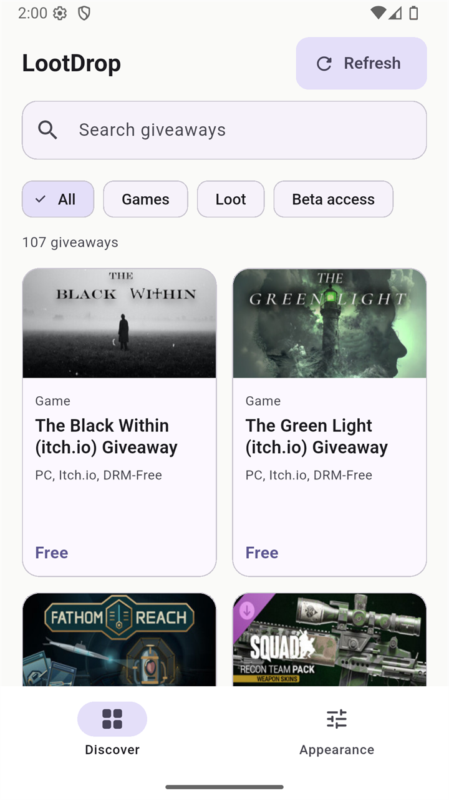
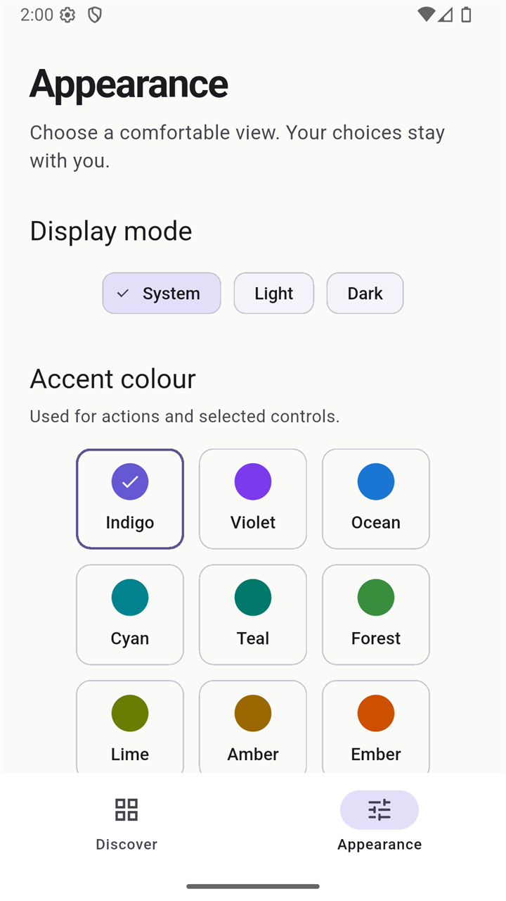

# LootDrop

LootDrop is a Flutter app that shows the games and in-game loot currently being given away for free. It reads the public [GamerPower](https://www.gamerpower.com/) API, presents the offers in a searchable, filterable grid, and links to the official claim pages. The interface keeps a text-only identity (no logo, no emoji, no decorative branding) and supports light, dark and system display modes with a choice of twelve accent colours.

**Course assignment** — MAD-III 33/44B Weekend, IT: read data from `https://www.gamerpower.com/api/giveaways`, display it in a grid view, use Riverpod for state, include bottom navigation, a game screen, a detail screen, a settings screen, dark-mode switching and colour-theme switching.

## Screenshots

| Discover | Giveaway details |
| --- | --- |
|  |  |
| **Appearance (light)** | **Discover (dark, Ocean accent — captured after a restart)** |
|  |  |

All screenshots were taken from the release APK running on an Android 16 (API 36) emulator at 1080×1920 (≈ 411 dp wide).

## Features

- **Live catalogue** from `https://www.gamerpower.com/api/giveaways` — 107 giveaways displayed during the verification run.
- **Grid view** that adapts its column count to the window width and to the user's text-scale setting.
- **Search** across title, platform and type, with a visible, live result count.
- **Category filters** — All, Games, Loot, Beta access — in a horizontally scrollable row.
- **Detail screen** — artwork, *Free to claim*, the original monetary value (labelled as such), platform/type tags, end date, description, instructions and a **Get giveaway** action.
- **Refresh** — an always-visible refresh action that keeps existing results on screen while loading, blocks duplicate requests, and shows a compact success toast in the bottom-right corner. On failure, previous results stay on screen and an inline **Retry** is offered.
- **Clear states** — loading skeletons, "No giveaways right now", "No matches found" with a *Clear search and filters* action, an initial-error screen with *Try again*, and an *Artwork unavailable* fallback when an image is missing or fails to load.
- **Appearance screen** — System / Light / Dark display mode and twelve accent colours (centred within their rows), persisted across restarts.
- **Bottom navigation** between Discover and Appearance.

## Assignment requirements → implementation

| Requirement | Where it lives |
| --- | --- |
| Read API `gamerpower.com/api/giveaways` | `lib/providers/feed_provider.dart` → `fetchGiveaways()` |
| Grid view of giveaways | `lib/widgets/catalogue_grid.dart`, `lib/widgets/giveaway_card.dart` |
| Riverpod state management | `lib/providers/` — see *State management* below |
| Bottom navigation bar | `lib/screens/home_screen.dart` — `NavigationBar` with Discover / Appearance |
| Game (discover) screen | `lib/screens/game_screen.dart` |
| Detail screen | `lib/screens/detail_screen.dart` |
| Settings screen | `lib/screens/settings_screen.dart` |
| Dark-mode switching | Display-mode chips (System / Light / Dark) + `lib/theme/app_theme.dart` |
| Colour-theme switching | Accent swatch picker (12 colours) + `lib/theme/app_theme.dart` |
| Persistent appearance | `SharedPreferences` (`theme_mode`, `theme_colour`) in `lib/providers/settings_provider.dart` |

## Architecture

```
lib/
├── main.dart                     # entry point: ProviderScope + LootDropApp
├── app.dart                      # MaterialApp wiring (theme mode, seed colour, load/error states)
├── models/
│   └── giveaway.dart             # Giveaway model, JSON parsing, hasValue() metadata guard
├── providers/
│   ├── feed_provider.dart        # http.Client, GamerPower request, Feed + FeedController
│   ├── browse_provider.dart      # search/category state, filtered(), bottom-nav index
│   └── settings_provider.dart    # appearance state + SharedPreferences persistence
├── screens/
│   ├── home_screen.dart          # bottom navigation (IndexedStack)
│   ├── game_screen.dart          # discover: compact scrolling header, search, filters, grid
│   ├── detail_screen.dart        # giveaway details + claim action
│   └── settings_screen.dart      # appearance controls
├── theme/
│   └── app_theme.dart            # Material 3 theme built from a seed colour; 12 accents
└── widgets/
    ├── artwork.dart              # network image with loading + failure fallback
    ├── catalogue_grid.dart       # responsive grid (skeleton cards while loading)
    ├── giveaway_card.dart        # card: artwork, type, title, platforms, "Free"
    ├── open_link.dart            # safe external-browser launching + error dialog
    └── result_toast.dart         # bottom-right success toast
```

### State management (Riverpod)

| Provider | Type | Owns |
| --- | --- | --- |
| `clientProvider` | `Provider<http.Client>` | the shared HTTP client (closed on dispose) |
| `feedProvider` | `AsyncNotifierProvider<FeedController, Feed>` | API state: items, `refreshing`, `failedRefresh`, and the refresh policy |
| `browseProvider` | `NotifierProvider<BrowseController, Browse>` | the search query and selected category |
| `navigationProvider` | `NotifierProvider<NavigationController, int>` | bottom-navigation index (Discover = 0, Appearance = 1) |
| `settingsProvider` | `AsyncNotifierProvider<SettingsController, Appearance>` | display mode + accent colour, persisted with SharedPreferences |

`filtered(items, browse)` is a pure function that composes the search query and category filter without mutating the API data.

## Data source

The app reads the free public GamerPower API:

- Endpoint: `https://www.gamerpower.com/api/giveaways`
- Service and documentation: https://www.gamerpower.com/

Giveaways belong to their respective publishers; every claim link points to the official offer page. LootDrop is not affiliated with GamerPower.

## Getting started

Prerequisites:

- Flutter 3.47.x (stable) with Dart 3.13.x — verified with Flutter 3.47.6 / Dart 3.13.5
- Android SDK (compile/target SDK 36; min SDK 24)

Run:

```bash
flutter pub get
flutter run            # choose the connected device or emulator
```

The Android manifest already declares `android.permission.INTERNET`, which the GamerPower request needs.

## Tests and release build

```bash
dart format --output=none --set-exit-if-changed lib test
flutter analyze
flutter test
flutter build apk --release
```

Current status (Flutter 3.47.6 / Dart 3.13.5):

- `dart format` — clean.
- `flutter analyze` — no issues.
- `flutter test` — **19/19 passing**: 7 core tests (parsing and metadata validation, search/filter composition, HTTP success and malformed responses, empty responses, the refresh policy — replaces on success, retains previous results on failure, suppresses duplicate requests — and settings persistence) plus 12 widget tests covering 320 / 390 / 768 logical-pixel widths × 1.0 / 2.0 text scale × light / dark themes, with fatal hit-test warnings and scrolling to genuinely tappable targets.
- `flutter build apk --release` — succeeds (49.1 MB universal APK).

## Download the demo APK

The demo is the release APK attached to the [v1.0.0 release](https://github.com/SRUN-Sochettra/LootDrop/releases/latest):

**`lootdrop-v1.0.0-android.apk`**

| | |
| --- | --- |
| Version | 1.0.0 (version code 1) |
| Application ID | `com.example.game_giveaways` |
| Android | 7.0+ (min SDK 24, target SDK 36) |
| Size | 49.1 MB (51,526,540 bytes), universal APK |
| SHA-256 | `BA9578E7450C8DB51923FD43B3BA9359C09E8475B4D480B489ED6D250EC7EC4D` |

> The APK is signed with the standard Flutter debug keystore — fine for evaluation, not for store distribution.

## Appearance persistence

Display mode and accent colour are stored in `SharedPreferences` under the keys `theme_mode` and `theme_colour`. Writes are optimistic: the UI updates immediately, and if a write fails the previous choice is restored with an inline message. Verified on device: switching to Dark + Ocean and restarting the app keeps both.

## Loading, error and empty behaviour

- **Loading** — six skeleton cards while the first request is in flight.
- **Empty API response** — "No giveaways right now" with a Refresh action.
- **No matches** — the current search/filters produced no results; one button clears both.
- **Initial error** — an explanatory message with *Try again*.
- **Refresh failure** — previous results are kept, with "Could not refresh. Showing previous results." and a *Retry* action.
- **Image failure** — an *Artwork unavailable* placeholder instead of a broken image.
- Missing metadata (`not available` / `n/a` / `null`) is omitted rather than rendered as blank pills.

## Verification status

Automated: `dart format` clean, `flutter analyze` clean, `flutter test` 19/19, `flutter build apk --release` succeeds — all re-run after the final dependency change.

Manual checks on the release APK (Android 16 / API 36 emulator, 1080×1920 ≈ 411 dp):

- Fresh launch loads the catalogue (107 giveaways on 19 Oct 2026).
- Detail screen opens; *Free to claim*, *Original value: $5.99*, tags and end date render; no blank pills.
- Search `itch` → "15 giveaways matching your search"; the clear button restores the full list.
- Filters: Games → 16, Loot → 0 (empty state), Beta access → 0 (empty state), All → 107.
- Refresh keeps results on screen and shows the "Giveaways refreshed" toast bottom-right (duplicate-request blocking is covered by tests, not raced manually).
- **Get giveaway** opens the external browser (Chrome) and loads the official itch.io offer page.
- Dark mode + accent change persist across a force-stop and relaunch.
- 200% system font scale → single-column grid, no overflow; 320 dp width → single-column layout.

Not verified: iOS / macOS / Linux / Windows / web builds, physical-device behaviour, screen readers (TalkBack), and store-distribution signing.

## Known limitations

- The release APK is signed with the debug keystore and is a universal APK (contains all ABIs), hence ≈ 49 MB.
- The application ID is the Flutter default `com.example.game_giveaways`.
- Data is fetched live on each launch; there is no offline cache.
- `shared_preferences_android` is pinned to `2.4.28` through a documented `dependency_overrides` entry: the 2.5.0 release rewrote the plugin to Pigeon-JNI without shipping R8 keep rules, and the first preferences read hangs in minified release builds ([flutter/flutter#194701](https://github.com/flutter/flutter/issues/194701)). Remove the pin once an upstream fix ships.
- GamerPower is a public free API; if it is unreachable or rate-limited, the error/retry states apply.

## Author

**Srun Sochettra** — GitHub: [SRUN-Sochettra](https://github.com/SRUN-Sochettra)

Source code: https://github.com/SRUN-Sochettra/LootDrop
